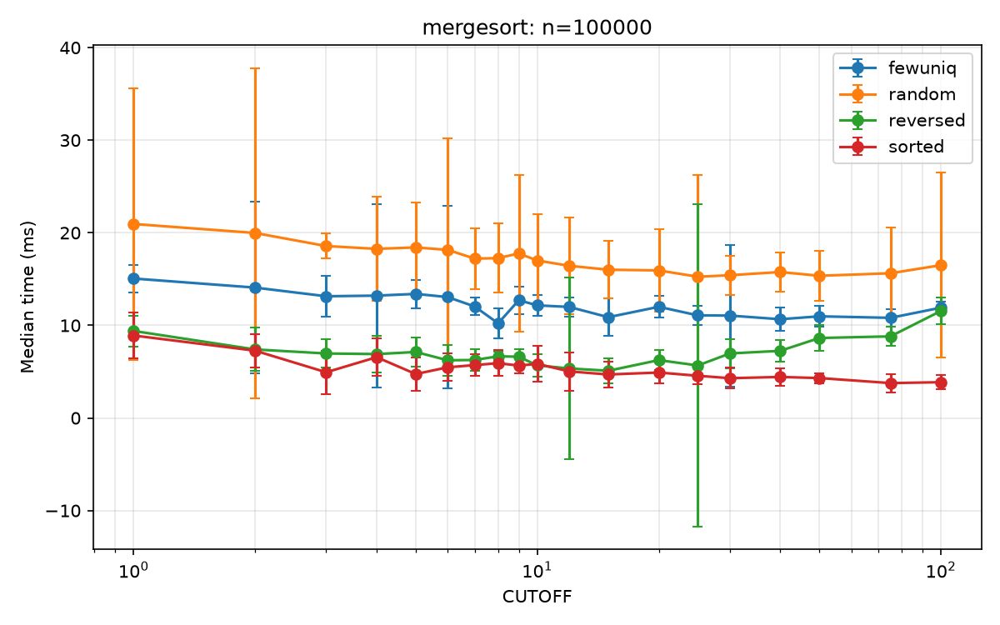
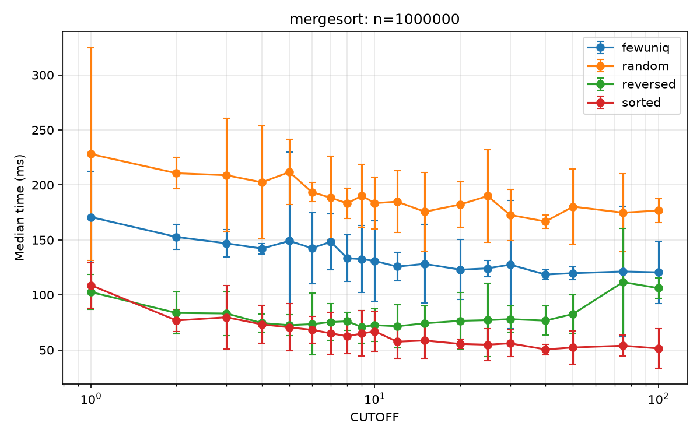
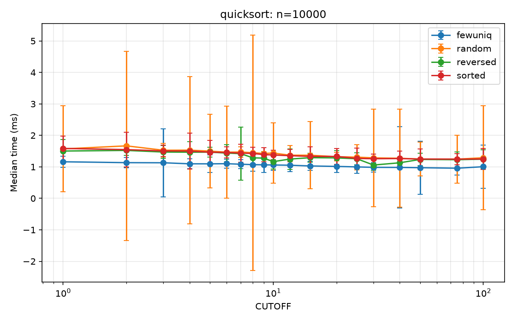
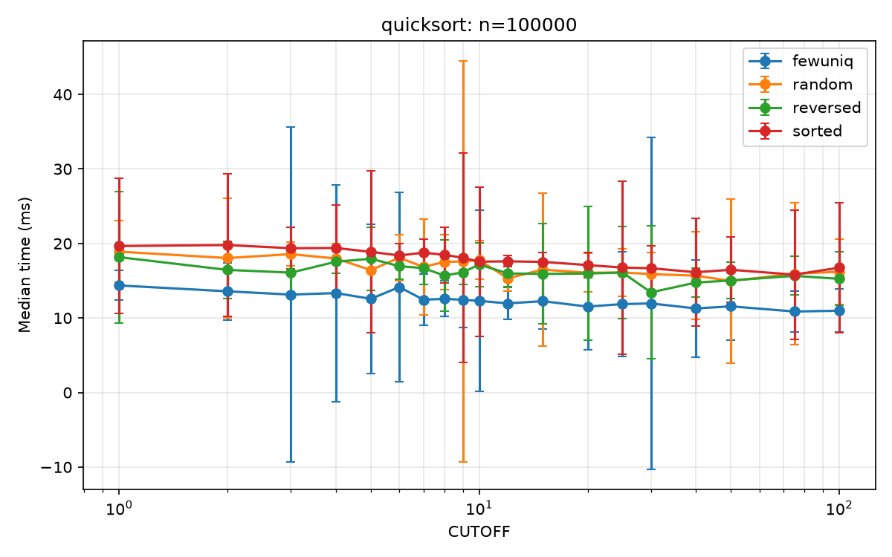
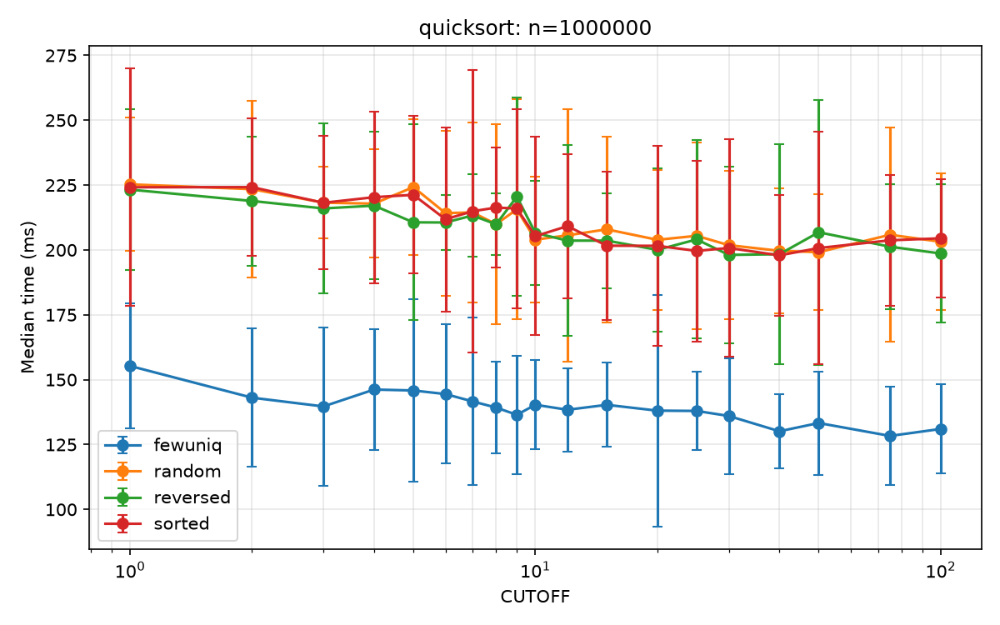
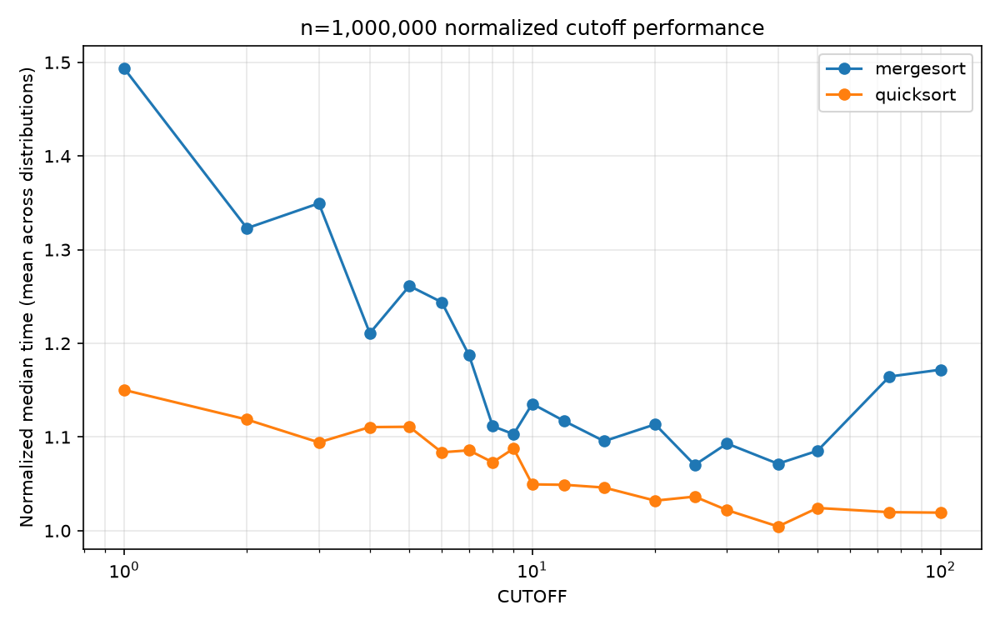

# Báo cáo: Tìm vùng CUTOFF tối ưu cho Mergesort và Quicksort

> **Ngôn ngữ:** Java 21 · **Ngày thực hiện:** 30/10/2026

---

## 1. Mục tiêu

Xác định thực nghiệm **vùng giá trị CUTOFF** tối ưu — tức kích thước mảng con mà bên dưới đó thuật toán chuyển sang Insertion Sort thay vì tiếp tục đệ quy — cho **Mergesort** (top-down) và **Quicksort** (Sedgewick & Wayne) trên máy đo hiện tại. Phân phối `random` được chọn là ca đại diện chính; ba phân phối còn lại (`sorted`, `reversed`, `fewuniq`) là phụ. Các giá trị tham chiếu từ sách giáo khoa là **7** (bản cũ) và **10** (bản mới).

---

## 2. Môi trường đo

| Thông số | Giá trị |
|---|---|
| Hệ điều hành | Windows 10 10.0 |
| CPU | Intel Core i5-6200U @ 2,30 GHz (xung tối đa theo WMI: 2.400 MHz) |
| Số nhân vật lý / logic | 2 / 4 (Hyper-Threading) |
| Cache L2 | 512 KB tổng (256 KB mỗi nhân) |
| Cache L3 | 3.072 KB (3 MB, dùng chung) |
| RAM | ~7,9 GB (8.467.230.720 bytes) |
| Java | 21.0.11+10-LTS |
| JVM flags | `-Xms2g -Xmx2g -XX:+UseSerialGC` |

> [!WARNING]
> i5-6200U là CPU laptop thế hệ Skylake (2015), chỉ có 2 nhân vật lý, L3 cache nhỏ (3 MB). Với n=10⁶ phần tử int (≈ 4 MB), dữ liệu **vượt L3 cache**, làm tăng chi phí truy cập bộ nhớ và có thể khiến CPU giảm xung nhịp (thermal throttling) nếu chạy lâu. Đây là nguồn nhiễu quan trọng cần lưu ý.

---

## 3. Cài đặt

### 3.1 Mergesort (top-down, slides 2.2)

```
sort(a, aux, lo, hi):
  if hi <= lo + CUTOFF - 1: insertion(a, lo, hi); return
  mid = lo + (hi-lo)/2
  sort(a,aux,lo,mid); sort(a,aux,mid+1,hi); merge(a,aux,lo,mid,hi)
```

Mảng phụ `aux` cấp phát **một lần duy nhất** mỗi lần gọi `sort` công khai. Không dùng tối ưu "dừng nếu đã sắp xếp" hay hoán đổi vai trò `aux` — CUTOFF là biến duy nhất.

### 3.2 Quicksort (slides 2.3)

```
sort(a, cutoff): shuffle(a, seed_per_rep); sort(a, 0, n-1)
sort(a, lo, hi):
  if hi <= lo + CUTOFF - 1: insertion(a, lo, hi); return
  j = partition(a, lo, hi); sort(a, lo, j-1); sort(a, j+1, hi)
```

Xáo trộn Fisher-Yates với seed cố định theo từng rep nằm **trong** vùng đo thời gian. Không dùng median-of-3, không dùng 3-way partitioning. Scan dừng khi gặp phần tử bằng pivot (đúng theo lecture).

### 3.3 Lưu ý kiểu dữ liệu

Mảng dùng `int[]` thay vì `Comparable[]` như slide gốc. Phép so sánh `less(a,b)` được thay bằng `a < b` (nguyên thủy, không boxing), có thể loại bỏ overhead virtual dispatch (chưa đo). Ảnh hưởng của điều này lên CUTOFF tối ưu chưa được kiểm chứng.

Tính đúng đắn của các cài đặt đã được kiểm chứng qua `Verify.java` (vượt qua 1216/1216 kiểm tra).

---

## 4. Thiết kế thí nghiệm

### 4.1 Dữ liệu

| Phân phối | Mô tả | Vai trò |
|---|---|---|
| `random` | Số nguyên đều ngẫu nhiên trong [0, 2³¹−1) | **Chính** |
| `sorted` | Tăng dần | Phụ |
| `reversed` | Giảm dần | Phụ |
| `fewuniq` | Ngẫu nhiên từ 100 giá trị phân biệt (nhiều trùng) | Phụ |

Kích thước: **n = 10.000, 100.000, 1.000.000**. Sinh bởi `GenData.java`, seed cố định 42.

### 4.2 CUTOFF thử nghiệm

```
1, 2, 3, 4, 5, 6, 7, 8, 9, 10, 12, 15, 20, 25, 30, 40, 50, 75, 100
```

### 4.3 Phương pháp đo

- **Warm-up JVM:** 5 vòng không đo trước mỗi tổ hợp (algo, dist, n).
- **REPS:**
  - n ≤ 100.000: **15** lần lặp.
  - n = 1.000.000: **25** lần lặp *(lần chạy lại với nhiều REPS hơn để giảm nhiễu sau khi phát hiện outlier trong lần đo trước)*.
- **Thứ tự CUTOFF ngẫu nhiên hóa** trong mỗi rep để loại bỏ drift tuần hoàn.
- Đo bằng `System.nanoTime()`, chỉ bao `sort(copy, cutoff)`.
- Thống kê tóm tắt: **median**, mean, std, min, IQR trên toàn bộ REPS.

> [!NOTE]
> Lần chạy đầu tiên (REPS=9 cho n=10⁶) có một số outlier rõ rệt — ví dụ quicksort/reversed với std lên tới 202 ms (~92% median). Lần chạy lại với REPS=25 cho kết quả ổn định hơn (std < 55 ms ở hầu hết tổ hợp), nhưng vẫn còn nhiễu đáng kể có thể do CPU throttling và L3 cache miss (nguyên nhân chưa xác định chắc chắn). **Các kết quả trong báo cáo này là từ lần chạy 25 REPS.**

---

## 5. Kết quả

### 5.1 Bảng CUTOFF tốt nhất và vùng gần tốt nhất (trong vòng 2% hoặc 1 IQR)

| Thuật toán | Phân phối | n | CUTOFF tốt nhất | Median tốt nhất (ms) | Vùng gần tốt nhất (2% hoặc 1 IQR) | C=7 (ms) | %Δ vs C=7 | C=10 (ms) | %Δ vs C=10 |
|---|---|---|---|---|---|---|---|---|---|
| mergesort | fewuniq | 10.000 | 40 | 0,9496 | 10–100 | 1,1761 | +23,9% | 1,0660 | +12,3% |
| mergesort | fewuniq | 100.000 | 8 | 10,221 | 6–100 | 12,036 | +17,8% | 12,161 | +19,0% |
| mergesort | **fewuniq** | **1.000.000** | **50** | **115,23** | 15;20;25;30;40;50;75;100 | 135,04 | +17,2% | 129,35 | +12,3% |
| mergesort | random | 10.000 | 50 | 1,1533 | 20–75 | 1,4102 | +22,3% | 1,2731 | +10,4% |
| mergesort | random | 100.000 | 25 | 15,252 | 6–100 | 17,209 | +12,8% | 17,006 | +11,5% |
| mergesort | **random** | **1.000.000** | **40** | **167,43** | 8;9;10;12;15;20;25;30;40;50;75;100 | 188,24 | +12,4% | 181,50 | +8,4% |
| mergesort | reversed | 10.000 | 10 | 0,5192 | 5–30 | 0,5897 | +13,6% | 0,5192 | 0,0% |
| mergesort | reversed | 100.000 | 15 | 5,0984 | 3–40 | 6,2629 | +22,8% | 5,6786 | +11,4% |
| mergesort | **reversed** | **1.000.000** | **9** | **64,291** | 2;4;5;6;7;8;9;10;12;15;20;25;30;40 | 73,075 | +13,7% | 69,219 | +7,7% |
| mergesort | sorted | 10.000 | 100 | 0,2828 | 40–100 | 0,4683 | +65,6% | 0,4340 | +53,5% |
| mergesort | sorted | 100.000 | 75 | 3,7668 | 3–100 | 5,7102 | +51,6% | 5,8449 | +55,2% |
| mergesort | **sorted** | **1.000.000** | **100** | **49,09** | 15;25;30;40;50;75;100 | 64,631 | +31,7% | 61,782 | +25,9% |
| quicksort | fewuniq | 10.000 | 75 | 0,9572 | 10–100 | 1,0844 | +13,3% | 1,0594 | +10,7% |
| quicksort | fewuniq | 100.000 | 75 | 10,869 | 12–100 | 12,452 | +14,6% | 12,299 | +13,2% |
| quicksort | **fewuniq** | **1.000.000** | **75** | **128,33** | 9;25;30;40;50;75;100 | 141,62 | +10,4% | 140,33 | +9,4% |
| quicksort | random | 10.000 | 75 | 1,2452 | 25–100 | 1,4706 | +18,1% | 1,4388 | +15,5% |
| quicksort | random | 100.000 | 50 | 14,966 | 5–100 | 16,853 | +12,6% | 17,768 | +18,7% |
| quicksort | **random** | **1.000.000** | **50** | **199,14** | 10;12;15;20;25;30;40;50;75;100 | 214,46 | +7,7% | 203,97 | +2,4% |
| quicksort | reversed | 10.000 | 30 | 1,0578 | 8–100 | 1,4193 | +34,2% | 1,1659 | +10,2% |
| quicksort | reversed | 100.000 | 30 | 13,438 | 2–100 | 16,692 | +24,2% | 17,182 | +27,9% |
| quicksort | **reversed** | **1.000.000** | **30** | **198,10** | 1–100 (tất cả) | 213,29 | +7,7% | 206,55 | +4,3% |
| quicksort | sorted | 10.000 | 75 | 1,2450 | 25–100 | 1,4366 | +15,4% | 1,3767 | +10,6% |
| quicksort | sorted | 100.000 | 75 | 15,817 | 10–100 | 18,764 | +18,6% | 17,560 | +11,0% |
| quicksort | **sorted** | **1.000.000** | **40** | **197,92** | 6;10;12;15;20;25;30;40;50;75;100 | 214,91 | +8,6% | 205,32 | +3,7% |

### 5.2 Bảng thống kê n=1.000.000 (REPS=25) — chọn các CUTOFF quan trọng

#### Mergesort, n = 1.000.000

| CUTOFF | fewuniq median (std) | random median (std) | reversed median (std) | sorted median (std) |
|---|---|---|---|---|
| 7 | 135,04 (17,0) | 188,24 (24,9) | 73,07 (15,5) | 64,63 (11,5) |
| 10 | 129,35 (39,7) | 181,50 (27,0) | 69,22 (9,4) | 61,78 (9,4) |
| 15 | 121,86 (15,8) | 177,70 (16,9) | 70,83 (10,6) | 57,02 (14,9) |
| 20 | 122,52 (40,9) | 172,12 (10,8) | 75,07 (10,9) | 58,66 (12,8) |
| 25 | 121,37 (30,2) | 171,51 (23,3) | 67,80 (6,8) | 56,37 (11,5) |
| 30 | 117,13 (36,9) | 174,77 (30,0) | 74,73 (13,2) | 56,42 (16,2) |
| 40 | 118,53 (27,1) | **167,43** (15,2) | 78,57 (17,3) | 50,81 (7,1) |
| 50 | **115,23** (20,0) | 173,84 (28,6) | 80,62 (11,3) | 51,50 (16,4) |
| 75 | 115,85 (33,3) | 177,41 (30,1) | 99,20 (16,7) | 51,55 (10,4) |
| 100 | 120,77 (14,4) | 175,75 (24,2) | 102,19 (31,0) | **49,09** (10,3) |

*(Đơn vị: ms. Giá trị tốt nhất trong cột được in đậm.)*

#### Quicksort, n = 1.000.000

| CUTOFF | fewuniq median (std) | random median (std) | reversed median (std) | sorted median (std) |
|---|---|---|---|---|
| 7 | 141,62 (32,3) | 214,46 (34,7) | 213,29 (15,8) | 214,91 (54,5) |
| 10 | 140,33 (17,1) | 203,97 (24,3) | 206,55 (19,9) | 205,32 (38,3) |
| 15 | 140,31 (16,2) | 207,95 (35,8) | 203,60 (18,2) | 201,64 (28,5) |
| 20 | 138,07 (44,6) | 203,92 (26,9) | 200,04 (31,4) | 201,59 (38,6) |
| 25 | 137,95 (15,1) | 205,45 (36,1) | 204,06 (38,2) | 199,64 (34,9) |
| 30 | 136,01 (22,4) | 201,85 (28,7) | **198,10** (34,0) | 200,77 (41,8) |
| 40 | 130,12 (14,3) | 199,67 (24,1) | 198,36 (42,5) | **197,92** (23,3) |
| 50 | 133,30 (19,9) | **199,14** (22,4) | 206,82 (51,0) | 200,73 (44,7) |
| 75 | **128,33** (18,9) | 205,86 (41,2) | 201,25 (24,0) | 203,73 (25,3) |
| 100 | 131,02 (17,1) | 203,16 (26,4) | 198,63 (26,6) | 204,50 (22,7) |

*(Đơn vị: ms. Giá trị tốt nhất trong cột được in đậm.)*

> [!NOTE]
> Các giá trị std còn khá lớn (thường 10–55 ms) dù đã dùng 25 REPS. Nhiều cặp CUTOFF liền kề cách nhau ít hơn 1 std — điều đó có nghĩa thứ hạng cục bộ **chưa có ý nghĩa thống kê**. Phân tích bên dưới tập trung vào xu hướng rộng thay vì các điểm tốt nhất cụ thể.

### 5.3 Đồ thị

#### Mergesort — n = 10.000


#### Mergesort — n = 100.000



#### Mergesort — n = 1.000.000



#### Quicksort — n = 10.000



#### Quicksort — n = 100.000



#### Quicksort — n = 1.000.000



#### Thời gian chuẩn hóa — n = 1.000.000 (trung bình các phân phối)



---

## 6. Phân tích

### 6.1 Vùng CUTOFF "phẳng" — giao của các phân phối tại n=10⁶

Thay vì báo cáo một giá trị tốt nhất duy nhất (không đáng tin do nhiễu), ta tìm **giao của các tập "gần tốt nhất" (trong vòng 2% hoặc 1 IQR) qua cả 4 phân phối** ở n=10⁶.

**Mergesort, n=10⁶:**

| Phân phối | Vùng gần tốt nhất (2% hoặc 1 IQR) |
|---|---|
| fewuniq | {15, 20, 25, 30, 40, 50, 75, 100} |
| random | {8, 9, 10, 12, 15, 20, 25, 30, 40, 50, 75, 100} |
| reversed | {2, 4, 5, 6, 7, 8, 9, 10, 12, 15, 20, 25, 30, 40} |
| sorted | {15, 25, 30, 40, 50, 75, 100} |
| **Giao** | **{15, 25, 30, 40}** |

> Vùng phẳng chung cho Mergesort: **CUTOFF ≈ 15–40**.

**Quicksort, n=10⁶:**

| Phân phối | Vùng gần tốt nhất (2% hoặc 1 IQR) |
|---|---|
| fewuniq | {9, 25, 30, 40, 50, 75, 100} |
| random | {10, 12, 15, 20, 25, 30, 40, 50, 75, 100} |
| reversed | {1–100} (gần phẳng, các giá trị nằm trong ngưỡng nhiễu; C=7 vẫn chậm hơn 7,7%) |
| sorted | {6, 10, 12, 15, 20, 25, 30, 40, 50, 75, 100} |
| **Giao** | **{25, 30, 40, 50, 75, 100}** |

> Vùng phẳng chung cho Quicksort: **CUTOFF ≈ 25–100** (100 là CUTOFF lớn nhất được thử nghiệm, nên cận trên chưa xác định).

### 6.2 Ca đại diện: `random`

**Mergesort/random/n=10⁶:** CUTOFF tốt nhất là 40 (167,4 ms), nhưng tập gần tốt nhất trải rộng từ 8 đến 100. Các giá trị 10–40 đều nằm trong khoảng 8,4% so với tốt nhất. Vùng thực sự phẳng (< 5% so với tốt nhất) khoảng **20–50**.

**Quicksort/random/n=10⁶:** Tốt nhất là 50 (199,1 ms). C=10 cho 203,97 ms — **chỉ chậm hơn 2,4%** và nằm trong tập gần tốt nhất. Điều này khẳng định **giá trị sách giáo khoa C=10 là chấp nhận được** với dữ liệu ngẫu nhiên. Vùng phẳng thực sự rất rộng: từ 10 đến 100 tất cả đều trong khoảng 4,5% của tốt nhất.

### 6.3 Ảnh hưởng của phân phối dữ liệu

**Mergesort:**
- `sorted`: hưởng lợi lớn nhất từ CUTOFF cao (C=100 tốt nhất: 49,1 ms; C=7 chậm hơn 31,7%). Insertion Sort trên subarray đã sắp xếp gần hoàn toàn gần như O(n) so sánh.
- `reversed`: thích CUTOFF thấp (C=9 tốt nhất: 64,3 ms). Insertion Sort trên subarray đảo ngược là O(n²) — phải giới hạn kích thước subarray.
- `fewuniq` và `random`: vùng phẳng rộng, kết quả tương đối ổn định từ 15–50.

**Quicksort:**
- Tất cả 4 phân phối đều có vùng phẳng rộng ở n=10⁶ (std lớn khiến khó phân biệt). Giá trị trong khoảng 25–100 luôn an toàn.
- `reversed` gần phẳng, các giá trị nằm trong ngưỡng nhiễu (C=7 vẫn chậm hơn 7,7%), do shuffle trước khi sort loại bỏ pattern đảo ngược — đây là thiết kế đúng theo lecture.

### 6.4 So sánh với C=7 và C=10

**Mergesort:**
- C=7 chậm hơn đáng kể: +12–32% ở n=10⁶ tùy phân phối. Ở `random`, chênh lệch (hiệu 20,8 ms) lớn hơn std của cấu hình tốt nhất (15,2 ms) nhưng nhỏ hơn std của C=7 (24,9 ms), do đó đây chưa phải bằng chứng thống kê mạnh mẽ; ở `sorted` hiệu là 15,5 ms, lớn hơn std của C=100 (10,3 ms, cấu hình tốt nhất) và của C=7 (11,5 ms).
- C=10 vẫn chậm hơn 8–26% ở n=10⁶, nhưng đã tốt hơn C=7 đáng kể.
- **Kết luận:** C=7 rõ ràng chưa tối ưu cho Mergesort; C=10 tốt hơn nhưng vẫn dưới mức tối ưu.

**Quicksort:**
- C=7 chậm hơn 7,7–10,4% ở n=10⁶, nhưng sự khác biệt nằm trong khoảng 1 std ở hầu hết tổ hợp (nhiễu cao).
- **C=10 với `random`: chỉ chậm hơn tốt nhất 2,4%** — nằm trong tập gần tốt nhất. Sách giáo khoa hoàn toàn hợp lý cho ca này.
- Tổng quát: Quicksort ít nhạy cảm với CUTOFF hơn Mergesort do vùng phẳng rất rộng.

### 6.5 Nhận xét về nhiễu đo lường

- Nhiều cặp CUTOFF liền kề cách nhau **ít hơn 1 std**, nghĩa là thứ hạng cụ thể (ví dụ CUTOFF=40 vs 50 vs 75) không có ý nghĩa thống kê — chúng về cơ bản ngang nhau.
- Quicksort/reversed/n=10⁶ trong lần chạy đầu (REPS=9) có std = 202 ms (92% median) — nguyên nhân gây ra outlier chưa được xác định chắc chắn (JIT re-compilation hay thermal throttling chỉ là các giả thuyết). Với REPS=25, std giảm xuống khoảng 7–55 ms nhưng vẫn đáng kể.

---

## 7. Kết luận

### 7.1 CUTOFF khuyến nghị

> [!IMPORTANT]
> Vì nhiễu đo còn đáng kể và đường cong phẳng trong vùng rộng, **không nên tuyên bố một giá trị tốt nhất duy nhất**. Thay vào đó, khuyến nghị theo vùng:

| Thuật toán | Vùng khuyến nghị | Cơ sở |
|---|---|---|
| **Mergesort** | **CUTOFF = 15–40** | Giao của tập gần tốt nhất qua 4 phân phối ở n=10⁶; C=7 chậm hơn giá trị tốt nhất 12–32% (lưu ý: `sorted` ưa chuộng CUTOFF còn lớn hơn, tốt nhất tại 100) |
| **Quicksort** | **CUTOFF = 25–100** | Giao của tập gần tốt nhất qua 4 phân phối ở n=10⁶; curve rất phẳng trong vùng này (100 là CUTOFF lớn nhất được thử nghiệm, nên cận trên chưa xác định) |

**Giá trị điểm nếu bắt buộc chọn một:**
- Mergesort: **C=25** (nằm chắc trong giao; không quá lớn để bất lợi với `reversed`). C≈25 là điểm thỏa hiệp giữa `reversed` (thích CUTOFF thấp) và `sorted` (thích CUTOFF cao). Tiêu chí near-best khá rộng lượng (với Mergesort/reversed, C=40 chậm hơn khoảng 22% so với giá trị tốt nhất; ở n=10⁶ reversed, C=25 chậm hơn khoảng 5,5% trong khi C=30 chậm hơn khoảng 16%).
- Quicksort: **C=40**: nằm trong vùng, gần tốt nhất ở sorted/random (ở n = 10⁶, C=40 nằm trong khoảng 1,4% của giá trị tốt nhất ở cả 4 phân phối: random +0,3%, reversed +0,1%, sorted 0%, fewuniq +1,4%).

**Về giá trị sách giáo khoa:**
- C=7: Mergesort chậm hơn rõ rệt; Quicksort chậm hơn khoảng 8–10% nhưng trong phạm vi nhiễu.
- C=10: Chấp nhận được cho **Quicksort/random** (chỉ chậm hơn 2,4%); vẫn dưới mức tối ưu cho Mergesort (~8% chậm hơn tốt nhất ở `random`).

### 7.2 Giới hạn và Threats to Validity

| Mối đe dọa | Mô tả |
|---|---|
| **JIT compilation** | JVM có thể biên dịch lại code giữa các lần đo, gây spike không dự đoán được. Warm-up giúp một phần. |
| **Nhiễu còn lại** | Dù REPS=25, std vẫn khoảng 7–55 ms; nhiều thứ hạng cục bộ không có ý nghĩa thống kê. |
| **`int[]` thay `Comparable[]`** | CUTOFF tối ưu có thể khác nếu dùng Comparable[], chưa kiểm chứng. |
| **Một máy duy nhất** | i5-6200U laptop với L3=3 MB nhỏ hơn dữ liệu 10⁶ phần tử. Kết quả không nhất thiết khái quát cho desktop/server. |
| **Thermal throttling** | CPU laptop có thể giảm xung trong các bài test dài, làm méo kết quả n=10⁶. |
| **Seed shuffle cố định** | Dùng cùng seed giữa các CUTOFF trong cùng một rep (so sánh ghép cặp công bằng - fair paired comparison), nhưng kết quả chỉ phản ánh 25 hoán vị (permutations). |
| **Tiêu chí "near-best"** | Quy tắc "near-best" (trong vòng 2% hoặc 1 IQR) là quy tắc heuristic, không phải kiểm định thống kê (statistical test). |
| **Lần chạy ban đầu** | Lần đo đầu (REPS=9) có outlier lớn (std > 90% median ở quicksort/reversed/n=10⁶); được thay thế bằng lần chạy REPS=25 (raw.csv vẫn giữ dữ liệu cũ). |

---

## 8. Cách chạy lại

Yêu cầu: Java 17 trở lên, Python 3 với `pandas` và `matplotlib`.

1. Kiểm tra tính đúng đắn của code:
   `javac -d out src\*.java` rồi `java -cp out Verify`
2. Chạy toàn bộ thí nghiệm (vài phút đến khoảng 30 phút tùy máy, nên cắm sạc và đóng các app khác):
   `powershell -ExecutionPolicy Bypass -File scripts\run_all.ps1`
3. Chạy lại riêng n = 10^6 với 25 lần lặp:
   `powershell -ExecutionPolicy Bypass -File scripts\run_n1e6.ps1`
4. Tổng hợp thống kê và vẽ đồ thị (chạy từ thư mục gốc của dự án):
   `python scripts\analyze.py`

---
