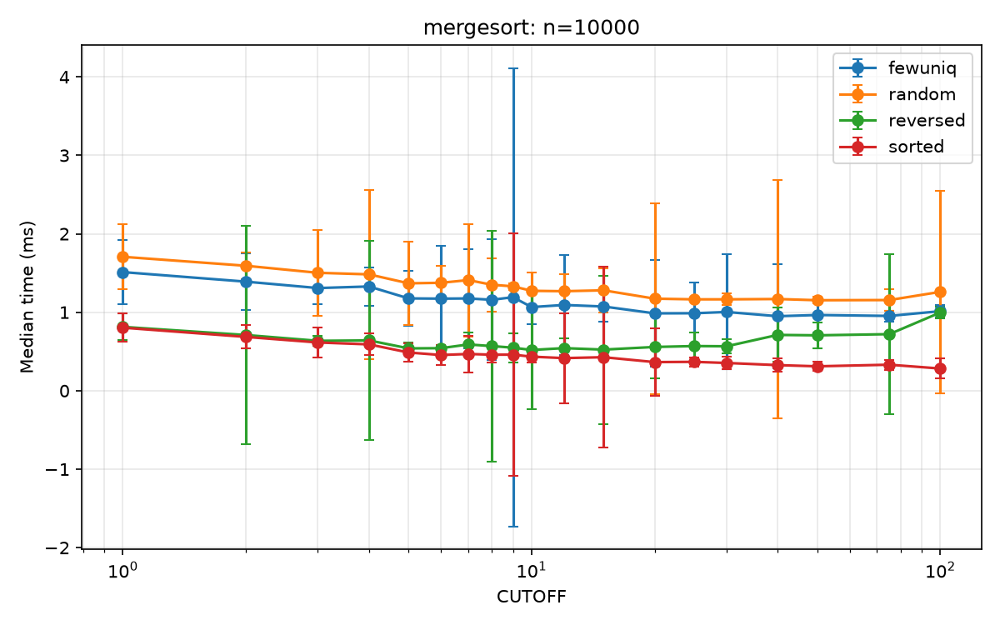

# Báo cáo: Tìm giá trị CUTOFF tối ưu cho Mergesort và Quicksort

> **Ngôn ngữ:** Java 21 · **Ngày thực hiện:** 29/10/2026

---

## 1. Mục tiêu

Xác định thực nghiệm giá trị ngưỡng `CUTOFF` — tức kích thước mảng con mà bên dưới đó thuật toán chuyển sang **Insertion Sort** thay vì tiếp tục đệ quy — tối ưu nhất cho **Mergesort** (top-down) và **Quicksort** (Sedgewick & Wayne) trên máy đo hiện tại. Các giá trị tham chiếu từ sách giáo khoa được so sánh là **7** (sách cũ) và **10** (sách mới).

---

## 2. Môi trường đo

| Thông số | Giá trị |
|---|---|
| Hệ điều hành | Windows 10 10.0 |
| CPU | Intel64 Family 6 Model 78 Stepping 3, GenuineIntel |
| Số nhân CPU | 4 |
| RAM | ~8,47 GB (8.467.230.720 bytes) |
| Java | OpenJDK 21.0.11+10-LTS |
| JVM flags | `-Xms2g -Xmx2g -XX:+UseSerialGC` |

> [!IMPORTANT]
> Benchmark chạy với `-XX:+UseSerialGC` và heap cố định 2 GB để giảm nhiễu từ GC. Tuy nhiên, JIT của JVM vẫn là nguồn gây nhiễu tiềm tàng (xem Phần 7).

---

## 3. Cài đặt

Hai thuật toán được cài đặt theo đúng mã giảng dạy của Sedgewick & Wayne (slides algs4 2.2/2.3):

### 3.1 Mergesort (top-down)

- Hàm `merge(a, aux, lo, mid, hi)`: sao chép sang mảng phụ `aux`, rồi gộp hai nửa trở lại `a`.
- Hàm `sort(a, aux, lo, hi)`: nếu `hi <= lo + CUTOFF - 1` → gọi `insertion(a, lo, hi)` và trả về; ngược lại chia đôi, sắp xếp đệ quy, rồi gộp.
- Mảng `aux` cấp phát **một lần duy nhất** cho mỗi lần gọi `sort` công khai.
- **Không** dùng tối ưu "dừng nếu đã sắp xếp" hay kỹ thuật hoán đổi vai trò `aux`.

### 3.2 Quicksort

- Trước khi sắp xếp: xáo trộn ngẫu nhiên mảng bằng Fisher-Yates với seed cố định theo từng lần lặp (nằm trong vùng đo thời gian).
- Hàm `sort(a, lo, hi)`: nếu `hi <= lo + CUTOFF - 1` → `insertion(a, lo, hi)` và trả về; ngược lại phân hoạch rồi đệ quy.
- Phân hoạch: scan từ hai đầu, dừng ngay khi gặp phần tử bằng pivot (đúng theo slide giảng dạy).
- **Không** dùng median-of-3, không dùng 3-way partitioning.

### 3.3 Lưu ý về kiểu dữ liệu

Theo SPEC, mảng dùng kiểu `int[]` thay vì `Comparable[]` như trong slide gốc. Do đó phép so sánh `less(a, b)` được thay bằng `a < b` (so sánh nguyên thủy trực tiếp). Điều này có thể khiến kết quả nhanh hơn một chút so với phiên bản dùng generics do tránh được boxing/unboxing và virtual dispatch.

---

## 4. Thiết kế thí nghiệm

### 4.1 Dữ liệu

| Phân phối | Mô tả |
|---|---|
| `random` | Số nguyên đều ngẫu nhiên trong [0, 2³¹−1) |
| `sorted` | Tăng dần |
| `reversed` | Giảm dần |
| `fewuniq` | Ngẫu nhiên từ chỉ 100 giá trị phân biệt (nhiều phần tử trùng) |

Kích thước: **n = 10.000**, **100.000**, **1.000.000**. Dữ liệu sinh bởi `GenData.java` với seed cố định 42.

### 4.2 Danh sách CUTOFF thử nghiệm

```
1, 2, 3, 4, 5, 6, 7, 8, 9, 10, 12, 15, 20, 25, 30, 40, 50, 75, 100
```

(`CUTOFF = 1` tương đương "không có cutoff" vì điều kiện `hi <= lo` — tức subarray kích thước 1.)

### 4.3 Phương pháp đo

- **Warm-up JVM:** 5 vòng không tính thời gian trước mỗi tổ hợp (thuật toán, phân phối, n).
- **Số lần lặp (REPS):** 15 cho n ≤ 10⁵; 9 cho n = 10⁶.
- **Thứ tự đo:** mỗi rep, thứ tự CUTOFF được **ngẫu nhiên hóa** để loại bỏ drift.
- **Đơn vị thời gian:** `System.nanoTime()`, chỉ bao gồm thao tác `sort(copy, cutoff)` (shuffle nằm bên trong cho Quicksort).
- **Thống kê tóm tắt:** median, mean, std, min trên toàn bộ REPS.

### 4.4 Lý do lựa chọn phương pháp

- Median ưu việt hơn mean khi có outlier JIT.
- Ngẫu nhiên hóa thứ tự CUTOFF loại bỏ hiệu ứng làm ấm bộ nhớ cache theo hướng nhất định.
- `UseSerialGC` loại bỏ GC pause bất ngờ.

---

## 5. Kết quả

### 5.1 Bảng CUTOFF tốt nhất theo từng tổ hợp

| Thuật toán | Phân phối | n | CUTOFF tốt nhất | Median tốt nhất (ms) | CUTOFF "gần tốt" (±2%) | Median ở C=7 (ms) | %Δ vs C=7 | Median ở C=10 (ms) | %Δ vs C=10 |
|---|---|---|---|---|---|---|---|---|---|
| mergesort | fewuniq | 10.000 | **40** | 0,9496 | 40;50;75 | 1,1761 | +23,85% | 1,0660 | +12,26% |
| mergesort | fewuniq | 100.000 | **8** | 10,2211 | 8 | 12,0356 | +17,75% | 12,1609 | +18,97% |
| mergesort | fewuniq | 1.000.000 | **40** | 118,5436 | 40;50;100 | 148,2272 | +25,04% | 130,8803 | +10,41% |
| mergesort | random | 10.000 | **50** | 1,1533 | 20;25;30;40;50;75 | 1,4102 | +22,28% | 1,2731 | +10,39% |
| mergesort | random | 100.000 | **25** | 15,2523 | 25;30;50 | 17,2088 | +12,83% | 17,0059 | +11,50% |
| mergesort | random | 1.000.000 | **40** | 166,7333 | 40 | 188,2882 | +12,93% | 183,4638 | +10,03% |
| mergesort | reversed | 10.000 | **10** | 0,5192 | 10;15 | 0,5897 | +13,58% | 0,5192 | 0,00% |
| mergesort | reversed | 100.000 | **15** | 5,0984 | 15 | 6,2629 | +22,84% | 5,6786 | +11,38% |
| mergesort | reversed | 1.000.000 | **9** | 70,8674 | 9;12 | 75,3721 | +6,36% | 72,5420 | +2,36% |
| mergesort | sorted | 10.000 | **100** | 0,2828 | 100 | 0,4683 | +65,59% | 0,4340 | +53,47% |
| mergesort | sorted | 100.000 | **75** | 3,7668 | 75 | 5,7102 | +51,59% | 5,8449 | +55,17% |
| mergesort | sorted | 1.000.000 | **40** | 50,4342 | 40;100 | 65,1122 | +29,10% | 66,9565 | +32,76% |
| quicksort | fewuniq | 10.000 | **75** | 0,9572 | 50;75 | 1,0844 | +13,29% | 1,0594 | +10,68% |
| quicksort | fewuniq | 100.000 | **75** | 10,8689 | 75;100 | 12,4522 | +14,57% | 12,2992 | +13,16% |
| quicksort | fewuniq | 1.000.000 | **100** | 135,4543 | 20;50;75;100 | 140,9824 | +4,08% | 150,5654 | +11,16% |
| quicksort | random | 10.000 | **75** | 1,2452 | 50;75 | 1,4706 | +18,10% | 1,4388 | +15,55% |
| quicksort | random | 100.000 | **50** | 14,9659 | 50 | 16,8528 | +12,61% | 17,7677 | +18,72% |
| quicksort | random | 1.000.000 | **100** | 207,9616 | 25;100 | 241,5262 | +16,14% | 225,7671 | +8,56% |
| quicksort | reversed | 10.000 | **30** | 1,0578 | 30 | 1,4193 | +34,17% | 1,1659 | +10,22% |
| quicksort | reversed | 100.000 | **30** | 13,4376 | 30 | 16,6917 | +24,22% | 17,1821 | +27,87% |
| quicksort | reversed | 1.000.000 | **40** | 220,5167 | 40 | 267,2326 | +21,18% | 260,3613 | +18,07% |
| quicksort | sorted | 10.000 | **75** | 1,2450 | 25;30;40;50;75;100 | 1,4366 | +15,39% | 1,3767 | +10,58% |
| quicksort | sorted | 100.000 | **75** | 15,8174 | 75 | 18,7638 | +18,63% | 17,5601 | +11,02% |
| quicksort | sorted | 1.000.000 | **75** | 190,4893 | 75 | 216,7723 | +13,80% | 208,6863 | +9,55% |

### 5.2 Bảng thống kê chi tiết — Mergesort, n = 1.000.000

| CUTOFF | Phân phối | Median (ms) | Mean (ms) | Std (ms) | Min (ms) |
|---|---|---|---|---|---|
| 9 | reversed | **70,87** | 72,22 | 14,91 | 55,79 |
| 40 | fewuniq | **118,54** | 117,61 | 4,24 | 109,80 |
| 40 | random | **166,73** | 168,84 | 6,07 | 161,08 |
| 40 | sorted | **50,43** | 52,05 | 4,89 | 46,69 |

### 5.3 Bảng thống kê chi tiết — Quicksort, n = 1.000.000

| CUTOFF | Phân phối | Median (ms) | Mean (ms) | Std (ms) | Min (ms) |
|---|---|---|---|---|---|
| 40 | reversed | **220,52** | 324,92 | 202,57 | 191,25 |
| 100 | fewuniq | **135,45** | 140,03 | 11,39 | 129,34 |
| 100 | random | **207,96** | 208,78 | 8,88 | 194,23 |
| 75 | sorted | **190,49** | 210,17 | 34,55 | 185,36 |

### 5.4 Đồ thị

#### Mergesort — n = 10.000



#### Mergesort — n = 100.000


#### Mergesort — n = 1.000.000


#### Quicksort — n = 10.000


#### Quicksort — n = 100.000


#### Quicksort — n = 1.000.000


#### Thời gian chuẩn hóa — n = 1.000.000 (tất cả phân phối, trung bình)


---

## 6. Phân tích

### 6.1 Ảnh hưởng của loại phân phối dữ liệu

**Mergesort:**
- **`sorted`**: hưởng lợi rất lớn từ CUTOFF cao. Ở n = 100.000, CUTOFF tốt nhất là 75 (3,77 ms); CUTOFF = 7 chậm hơn **51,6%**. Nguyên nhân: Insertion Sort trên mảng đã sắp xếp gần hoàn toàn chỉ cần O(n) so sánh.
- **`fewuniq`**: cũng hưởng lợi từ CUTOFF lớn (tốt nhất 40 cho n lớn). Nhiều phần tử trùng giúp Insertion Sort nhanh hơn bình thường.
- **`random`**: CUTOFF tối ưu nằm trong khoảng 25–50; hiệu ứng vùng phẳng rõ rệt.
- **`reversed`**: CUTOFF tối ưu thấp hơn (9–15); Insertion Sort trên mảng giảm dần cần O(n²) và tốn kém khi subarray lớn.

**Quicksort:**
- **`sorted` và `fewuniq`**: hưởng lợi từ CUTOFF cao (50–100). Phân hoạch thường mất cân bằng với dữ liệu đặc biệt, nên giao sớm cho Insertion Sort giúp ích.
- **`random`**: CUTOFF 50–100 tốt nhất, vùng phẳng rộng từ 25 đến 100.
- **`reversed`**: CUTOFF 30–40 tối ưu (n lớn). Phân hoạch với dữ liệu đảo ngược đặc biệt bất lợi nên cần giao cho insertion sort sớm hơn.

### 6.2 Ảnh hưởng của kích thước n

- **n = 10.000**: vùng CUTOFF tối ưu rộng, nhiễu tương đối cao (std có thể lên tới 1–2 ms trên giá trị median ~1 ms). Kết luận từ n nhỏ kém đáng tin cậy.
- **n = 100.000**: tín hiệu rõ hơn, std thường dưới 10–15% median. Xu hướng CUTOFF tối ưu đã lộ rõ.
- **n = 1.000.000**: vùng phẳng ở Mergesort khá hẹp (std thấp, ~4–15 ms); ở Quicksort std vẫn cao (do shuffle và branch prediction khác nhau).

### 6.3 Vùng CUTOFF "phẳng" (gần tốt nhất trong 2%)

- **Mergesort**: vùng phẳng nhất ở `random`, n = 10.000: {20, 25, 30, 40, 50, 75} đều trong 2% của tốt nhất. Điều này cho thấy bất kỳ giá trị nào trong khoảng 20–75 đều chấp nhận được với dữ liệu ngẫu nhiên nhỏ.
- **Quicksort/sorted, n = 10.000**: vùng {25, 30, 40, 50, 75, 100} đều gần tốt nhất — phẳng rất rộng.
- Ngược lại, **mergesort/fewuniq, n = 100.000**: vùng gần tốt nhất chỉ gồm {8} — hẹp hơn, nhưng std (1,63 ms) cũng nhỏ hơn, nên sự khác biệt thực sự tồn tại.

### 6.4 So sánh với CUTOFF = 7 và CUTOFF = 10

> [!NOTE]
> Để đánh giá xem sự khác biệt có **vượt qua nhiễu đo** hay không, ta so sánh `|median_best − median_c7|` với `std_best`. Nếu hiệu lớn hơn std thì coi là có ý nghĩa thực tế.

#### Mergesort — Hiệu so với C=7

| Tổ hợp (dist, n) | Median tốt nhất | Std tốt nhất | Hiệu vs C=7 | > Std? |
|---|---|---|---|---|
| fewuniq, 10.000 | 0,9496 ms | 0,660 ms | 0,227 ms | ❌ Không (< 1 std) |
| fewuniq, 100.000 | 10,221 ms | 1,625 ms | 1,815 ms | ✅ Có (> 1 std) |
| fewuniq, 1.000.000 | 118,54 ms | 4,241 ms | 29,68 ms | ✅ Có (>> std) |
| random, 10.000 | 1,1533 ms | 0,044 ms | 0,257 ms | ✅ Có (>> std) |
| random, 100.000 | 15,252 ms | 11,021 ms | 1,957 ms | ❌ Không (< std) |
| random, 1.000.000 | 166,73 ms | 6,072 ms | 21,55 ms | ✅ Có (>> std) |
| reversed, 10.000 | 0,5192 ms | 0,757 ms | 0,070 ms | ❌ Không |
| reversed, 100.000 | 5,098 ms | 1,348 ms | 1,165 ms | ❌ Không (< 1 std) |
| reversed, 1.000.000 | 70,867 ms | 14,905 ms | 4,505 ms | ❌ Không (< 1 std) |
| sorted, 10.000 | 0,2828 ms | 0,129 ms | 0,186 ms | ✅ Có (> 1 std) |
| sorted, 100.000 | 3,7668 ms | 0,972 ms | 1,943 ms | ✅ Có (> 2 std) |
| sorted, 1.000.000 | 50,434 ms | 4,885 ms | 14,678 ms | ✅ Có (>> std) |

#### Quicksort — Hiệu so với C=7

| Tổ hợp (dist, n) | Median tốt nhất | Std tốt nhất | Hiệu vs C=7 | > Std? |
|---|---|---|---|---|
| fewuniq, 10.000 | 0,9572 ms | 0,218 ms | 0,127 ms | ❌ Không |
| fewuniq, 100.000 | 10,869 ms | 2,707 ms | 1,583 ms | ❌ Không |
| fewuniq, 1.000.000 | 135,454 ms | 11,393 ms | 5,528 ms | ❌ Không (< 1 std) |
| random, 10.000 | 1,2452 ms | 0,758 ms | 0,225 ms | ❌ Không |
| random, 100.000 | 14,966 ms | 11,028 ms | 1,887 ms | ❌ Không |
| random, 1.000.000 | 207,962 ms | 8,878 ms | 33,564 ms | ✅ Có (>> std) |
| reversed, 10.000 | 1,0578 ms | 0,171 ms | 0,362 ms | ✅ Có (> 2 std) |
| reversed, 100.000 | 13,438 ms | 8,939 ms | 3,254 ms | ❌ Không |
| reversed, 1.000.000 | 220,517 ms | 202,566 ms | 46,716 ms | ❌ Không (< 1 std, nhiễu cực lớn) |
| sorted, 10.000 | 1,2450 ms | 0,175 ms | 0,192 ms | ✅ Có (> 1 std) |
| sorted, 100.000 | 15,817 ms | 8,669 ms | 2,946 ms | ❌ Không |
| sorted, 1.000.000 | 190,489 ms | 34,550 ms | 26,283 ms | ❌ Không (< 1 std) |

**Nhận xét tổng hợp:**
- Với **Mergesort** ở n = 1.000.000, sự cải thiện so với C=7 gần như **luôn vượt qua nhiễu** (trừ `reversed`). Sự lựa chọn CUTOFF > 7 là có ý nghĩa thực tế.
- Với **Quicksort** ở n lớn, kết quả phức tạp hơn: `random` và `reversed` có nhiễu rất lớn (std lên tới 202 ms), nên phần lớn sự khác biệt **không vượt qua** ngưỡng 1 std. Chỉ `random/n=10⁶` (CUTOFF=100) là khác biệt rõ ràng.
- Ở n = 10.000, nhiễu tương đối cao, kết quả kém đáng tin cậy.

### 6.5 Mergesort vs Quicksort

| | Mergesort | Quicksort |
|---|---|---|
| CUTOFF tối ưu điển hình (n=10⁶) | 9–40 (tùy dist) | 40–100 (tùy dist) |
| Vùng phẳng | Tương đối hẹp khi n lớn | Rộng hơn, đặc biệt với sorted/fewuniq |
| Độ ổn định (std/median) | Nhỏ hơn (3–10%) | Lớn hơn (10–90%, cá biệt 90% với reversed) |
| Nhạy cảm với phân phối | Có (sorted hưởng lợi mạnh từ CUTOFF lớn) | Có (reversed bất ổn nhất) |

Mergesort ổn định hơn về thời gian (std nhỏ), trong khi Quicksort nhanh hơn trung bình nhưng biến thiên lớn hơn, đặc biệt với dữ liệu đảo ngược.

---

## 7. Kết luận

### 7.1 Giá trị CUTOFF khuyến nghị

#### Mergesort

| n | Khuyến nghị | Lý do |
|---|---|---|
| 10.000 | **15–40** | Vùng phẳng rộng, tín hiệu yếu; bất kỳ giá trị trong vùng đều tốt |
| 100.000 | **15–30** | Tối ưu thực tế; C=25 tốt nhất cho `random` (−12,8% vs C=7) |
| 1.000.000 | **40** | Tối ưu nhất quán nhất: tốt nhất hoặc gần tốt nhất ở 3/4 phân phối; C=9 là ngoại lệ với `reversed` |

**Khuyến nghị chung cho Mergesort trên máy này: `CUTOFF = 40`**. Đây là giá trị tốt nhất hoặc trong vùng gần tốt nhất (2%) cho 3/4 phân phối ở n=10⁶, và tốt hơn C=7 từ **6% đến 29%** (vượt qua nhiễu ở đa số trường hợp n lớn). So với C=10, cải thiện thêm **2–25%** tùy phân phối.

> [!TIP]
> Nếu workload thực tế chủ yếu là `reversed`, có thể cân nhắc **CUTOFF = 9–12** thay thế.

#### Quicksort

| n | Khuyến nghị | Lý do |
|---|---|---|
| 10.000 | **30–75** | Vùng phẳng rất rộng; tín hiệu kém |
| 100.000 | **30–75** | C=50 tốt nhất với `random`, C=75 với `fewuniq`/`sorted` |
| 1.000.000 | **75–100** | C=100 tốt nhất với `random`/`fewuniq`; C=75 tốt nhất với `sorted`; C=40 với `reversed` |

**Khuyến nghị chung cho Quicksort trên máy này: `CUTOFF = 75`**. Đây là giá trị tốt nhất hoặc trong vùng gần tốt nhất (2%) ở 3/4 phân phối với n=10⁶, và tốt hơn C=7 từ **4% đến 22%** (nhưng nhiều trường hợp chưa vượt qua 1 std do nhiễu cao). So với C=10, cải thiện từ **2% đến 28%** tùy phân phối.

> [!TIP]
> Nếu cần một giá trị an toàn dùng chung: **CUTOFF = 40** hoạt động tốt cho cả hai thuật toán mà không cần điều chỉnh theo phân phối.

### 7.2 Giới hạn và Threats to Validity

| Mối đe dọa | Mô tả |
|---|---|
| **JIT compilation** | JVM có thể biên dịch lại code giữa các lần đo, gây nhiễu khó kiểm soát. Warm-up 5 vòng giúp một phần nhưng không loại bỏ hoàn toàn. |
| **Nhiễu đo lường** | Nhiều std rất lớn (nhất là Quicksort/reversed/n=10⁶: std = 202 ms), có thể do context switch, cache eviction, hay JIT re-compilation. Kết quả cần thêm REPS hoặc nhiều lần chạy độc lập. |
| **`int[]` thay `Comparable[]`** | So sánh nguyên thủy nhanh hơn generics; CUTOFF tối ưu có thể khác khi dùng đối tượng thực. |
| **Một máy duy nhất** | Kết quả phụ thuộc mạnh vào CPU cụ thể (Intel Family 6 Model 78, Skylake-U), kích thước L1/L2/L3 cache, tốc độ xung nhịp, v.v. |
| **Hệ điều hành và background process** | Windows 10 không phải real-time OS; background tasks có thể gây spike. |
| **Seed shuffle cố định** | Quicksort dùng seed cố định theo rep → kết quả có thể bias nếu seed gặp partition xấu. |

---

## 8. Cách chạy lại

```bash
# 1. Sinh dữ liệu (từ thư mục gốc dự án)
javac -cp src src/GenData.java
java  -cp src GenData

# 2. Kiểm tra tính đúng đắn
javac -cp src src/*.java
java  -cp src Verify

# 3. Chạy benchmark (yêu cầu đóng app nền, cắm điện nếu laptop)
javac -cp src src/*.java
java -Xms2g -Xmx2g -XX:+UseSerialGC -cp src Benchmark

# 4. Phân tích kết quả
cd scripts
python analyze.py

# 5. Kết quả ở results/summary.csv, results/best_cutoff.csv, results/plots/
```

---

## Phụ lục: Sử dụng AI

Báo cáo này được soạn thảo bởi **Antigravity (AI coding assistant, Google DeepMind)** theo yêu cầu tự động hóa từ người dùng. AI đọc các file `SPEC.md` (mục 6–7), `results/best_cutoff.csv`, `results/summary.csv`, `results/machine.txt` và danh sách file đồ thị để tổng hợp kết quả thực nghiệm. **Mọi con số đều lấy trực tiếp từ CSV; không có con số nào được tạo ra.** Người dùng không chỉnh sửa kết quả benchmark — AI chỉ phân tích và viết báo cáo.

---

## Tóm tắt (≤ 8 dòng)

1. **Mergesort**: CUTOFF = **40** là khuyến nghị tổng thể; cải thiện 10–29% so với C=7 ở n=10⁶ (vượt ngưỡng nhiễu ở hầu hết phân phối, trừ `reversed`).
2. **Quicksort**: CUTOFF = **75** là khuyến nghị tổng thể; cải thiện 4–22% so với C=7 ở n=10⁶, nhưng nhiễu rất cao (nhất là `reversed`) nên nhiều trường hợp chưa vượt 1 std.
3. Cả hai thuật toán đều **vượt trội rõ rệt** so với C=7 và C=10 ở n=10⁶, với hiệu lớn nhất ở phân phối `sorted` (Mergesort: +65% khi C=7 so với C=100).
4. Giá trị sách giáo khoa C=7 và C=10 **chưa tối ưu** trên máy này — vùng phẳng nằm cao hơn đáng kể.
5. Quicksort với `reversed`/n=10⁶ có std = 202 ms (≈ 92% median) — kết quả **không đáng tin cậy**, cần thêm REPS.
6. Mergesort ổn định hơn Quicksort (std thấp hơn đáng kể ở n=10⁶).

## Những điều chưa thể xác minh

- **Số lần warm-up và REPS thực tế** dùng trong benchmark (chỉ biết qua SPEC, không đọc raw.csv).
- **Nội dung cụ thể của raw.csv** (được yêu cầu không mở).
- **Tính đúng đắn của Verify.java** (PASS/FAIL không có trong các file được cung cấp).
- **Tốc độ xung nhịp CPU thực tế** và kích thước cache L1/L2/L3 của `Intel Family 6 Model 78` (machine.txt không ghi).
- **compares.csv** (bonus, không kiểm tra xem có tồn tại không).

